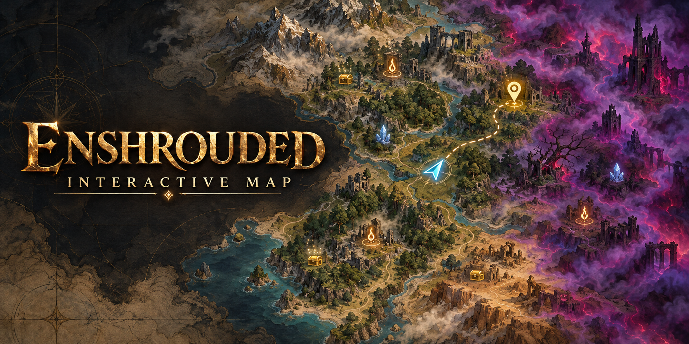

  

<h1 align="center">Enshrouded Interactive Map</h1>

  <b>The Enshrouded map that knows what's happening in your game — right now.</b> 
  Your position, your friends and everything you've already done, live, on your second monitor.

  
  
  
  
  

  🇺🇸 English · 🇧🇷 <a href="README.pt-BR.md">Português</a> · 🇪🇸 Español · 🇩🇪 Deutsch · 🇨🇳 简体中文

---

## 🔥 Where it came from

I looked for Enshrouded interactive maps and none of them satisfied me. So I made my own.

At first it was just a map showing where everything was, with the look of the in-game map. Playing with friends on
our server, I kept adding what I was missing: my position in real time, knowing what had already been done — the
chest a friend opened, the plant already harvested, the secret door already used —, friends on the map, living
creatures, pins synced with the game.

The idea is simple: **the game already knows all of this**, because it needs to in order to draw the world. The
map just checks every marker against memory and removes whatever no longer exists.

## ✨ What it does

| | |
|---|---|
| 🗺️ **The same map as the M key** | relief, contour lines and fog, drawn with the game's own shader |
| 🧭 **You, in real time** | position and heading, no need to open the in-game map |
| 👥 **Your friends** | everyone on the server on the map, with their names |
| ✅ **Done stuff disappears** | opened chests, picked items, harvested plants, buttons, barriers, locked and secret doors |
| 🐺 **Living creatures** | at their real position, with your target's health live |
| ⛏️ **Depleted ore** | the node leaves the map once you finish mining it |
| 📍 **Synced pins** | creating, deleting or renaming in the app changes the in-game map — and vice versa |
| 🔎 **Smart search** | find any item and see who drops it; **My filter** shows only what you're hunting |
| 🌍 **5 languages** | with the game's **official** names in each one |
| 🧵 **Routes and shortcuts** | route to any point; **F8** hides the closest point |

## 🚀 Getting started

1. Download the `.zip` from **[Releases](../../releases/latest)** and extract it.
2. Open **`Mapa Interactive Enshrouded.exe`** with the game running.
3. Done — within a few seconds it finds you on the map.

> 💡 Works best on a second monitor, with the game in **borderless window** mode.

**Requirements:** Windows 10/11 · Enshrouded 1.0 (Steam). Tested in October 2026 — a game update may break parts
until a new version comes out.

**Privacy:** nothing leaves your machine. No internet, no telemetry, no account.

## ⚙️ How it works

<b>Memory reading</b> (the map only reads)

 

The exe opens the game with `PROCESS_VM_READ` and reads it with `ReadProcessMemory`:

| data | source |
|---|---|
| position and camera | addresses the app finds and validates on its own at startup — usually survives game updates |
| chests, items, plants | entities loaded around you (~95 m); a fixed item that vanished = picked up |
| buttons, barriers, doors | toggle, lock and interaction state |
| creatures | position and health; a spawn with no living creature leaves the map |
| ore | terrain blocks (dug + original); depleted = no group of 6+ blocks left |
| lore read, fog | your local save (`.ksd`), read only |

State is remembered after you walk away, so nothing pops back up for no reason.

<b>Synced pins</b> (the only part that writes to the game)

 

To create markers on the in-game map, the exe loads an embedded DLL into the game process
(`LoadLibraryW` via `CreateRemoteThread`). It finds the game's own marker functions **by byte pattern** — if a
pattern doesn't match exactly once, it does nothing — and calls them on the game thread, receiving requests through
a local pipe. Pins are saved to your character like any marker.

## 🌍 Languages

| text | source | file |
|---|---|---|
| game names (items, creatures, quests…) | the game's **official** text | `app/public/lang/<language>.json` |
| interface (buttons, menus, hints) | our translation — corrections welcome | `app/src/i18n/<language>.json` |

**Want the map in your language?** Copy `app/src/i18n/en.json` to `<code>.json`, translate the values (keep the
keys), add the language to `app/src/i18n.js` and open a pull request. We generate the game names from the official
text.

## 🛠️ Building

Releases are built by **GitHub Actions** from this repository, with a
[public log](../../actions/workflows/build.yml) — you can check that the binary came from this code.

Locally (Node 20+, Rust stable, Windows): run `compilar.bat`.

Where things are

 

| folder | contents |
|---|---|
| `app/src` | interface (React + Leaflet); the WebGL2 map is in `gamemap.js` |
| `app/src-tauri/src` | `tracker.rs` (position), `live.rs` (live state), `terreno.rs` (ore), `injetor.rs` (pins) |
| `injector/marcador` | the pins DLL (built and embedded into the exe automatically) |
| `app/public` | ready-made data: markers, icons, tiles |

Code comments are in Portuguese.

## ❤️ Credits

- **Keen Games** — for Enshrouded. Game names, map shader and textures come from the game files.
- **[kfc-parser](https://github.com/Brabb3l/kfc-parser)** by brabb3l — used to read the game's resources.
- And to my friends on the server, who tested every version in the middle of our sessions.

Also by the same author: **Enshrouded Save Editor** and **Enshrouded Server Guardian**.

---

  
    Fan project, not affiliated with Keen Games. No official support — use, read, modify and publish freely. 
    Code under <a href="LICENSE">MIT</a>. The data in <code>app/public</code> belongs to Keen Games.
  

